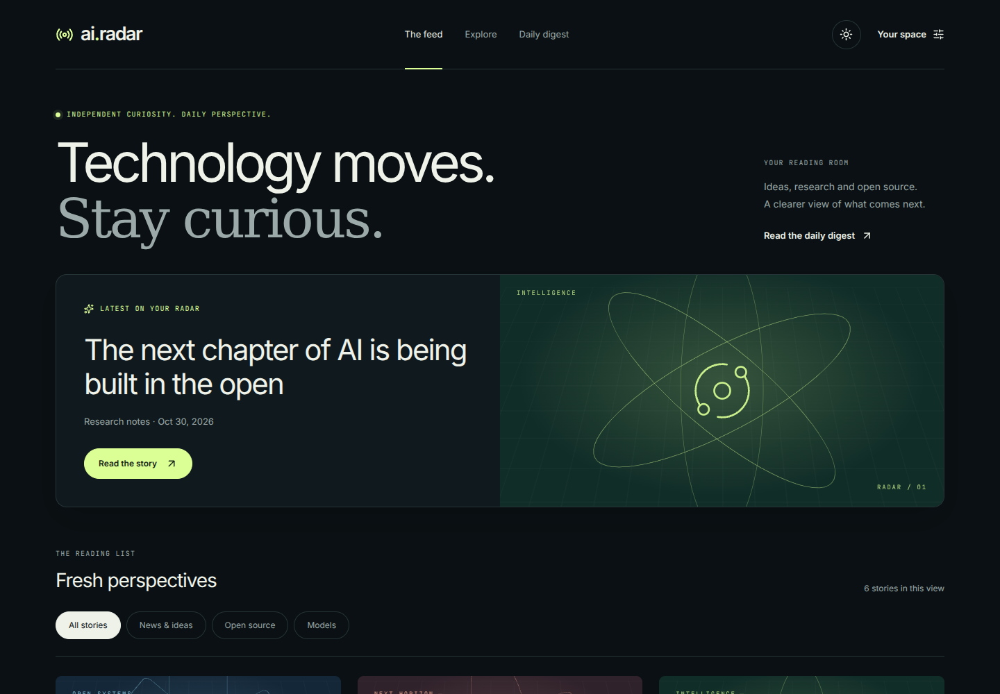
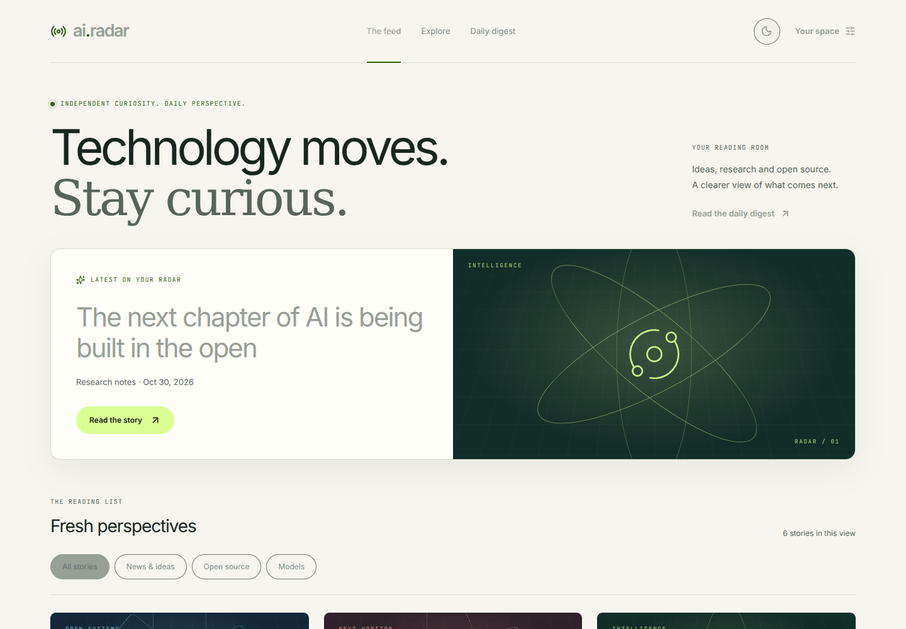
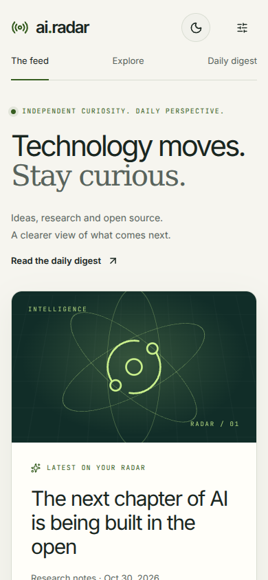
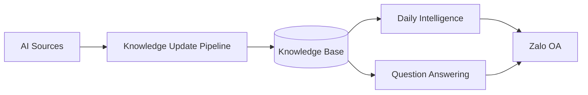

<div align="center">

# AI-Radar

### Knowledge Intelligence System for AI Research

<div align="center">Automatically collect, process, organize, and retrieve AI knowledge through Daily Intelligence</div>
<div align="center">and Semantic Question Answering.</div>

<div style="margin-top: 20px;">


</div>
</div>

---

# 🚀 Overview

AI-Radar is a **Knowledge Intelligence System** designed to address the growing challenge of information overload in the rapidly evolving AI ecosystem.

Instead of acting as a chatbot or a simple RSS aggregator, AI-Radar continuously transforms fragmented AI information into structured knowledge that can be consumed through:

- 📬 Daily AI Intelligence Digest
- 🔍 Semantic Question Answering (RAG)
- 📚 Long-term Knowledge Base

The project follows a **Documentation-First** approach, where every architectural and implementation decision is documented before development begins.

---

# ❓ Why AI-Radar?

Modern AI knowledge is scattered across:

- Research Papers
- GitHub Repositories
- Hugging Face
- Technical Blogs
- Newsletters
- Community Discussions

AI-Radar continuously collects, filters, processes and transforms those sources into a searchable knowledge base, allowing users to stay updated without manually following dozens of information channels.

---

# ✨ Key Features

- 🤖 Automated Knowledge Collection
- 🧠 Knowledge Processing & Normalization
- 📬 Daily AI Intelligence Digest
- 🔎 Semantic Question Answering (RAG)
- 💬 Zalo Official Account Integration
- 📦 Structured Knowledge Storage

---

# 📸 Project Preview

A reading-first web experience for AI news, research, and open-source projects.



> Screenshots show the current interface with illustrative fixture articles,
> not live news or ingestion results. The artwork is decorative.

<details>
<summary>Light theme and mobile preview</summary>





</details>

The web interface currently includes:

- **The feed:** a featured story, article cards, source-category filters, and pagination.
- **Explore:** browse stored knowledge and open article details with source links.
- **Daily digest:** browse saved editions; opening the page does not generate or send a digest.
- **Your space:** switch between dark and light themes.

Run the interface locally using [Getting Started](#-getting-started).

---

# 🏗 High-Level Workflow



For the complete architecture, please refer to the **Architecture Documentation**.

---

# 📚 Documentation

The project documentation is organized into dedicated document sets.

| Document                              | Description                                  |
| ------------------------------------- | -------------------------------------------- |
| 📘 **Software Design Document (SDD)** | Requirements, system design and data model   |
| 🏛 **Architecture**                    | System organization, runtime and operations  |
| 📝 **Decision Log**                   | Design rationale and architectural decisions |
| 🔌 **API Specification**              | Internal APIs and Webhook reference          |

> All detailed technical documentation is located in the **docs/** directory.

---

# 🛠 Tech Stack

| Category        | Technology              |
| --------------- |-------------------------|
| Language        | Python 3.12             |
| AI Framework    | LangChain               |
| LLM Provider    | Groq API - Ollama       |
| Embedding       | Cohere Embeddings       |
| Vector Database | Qdrant                  |
| Scheduler       | Self-implement          |
| Notification    | Zalo Official Account   |
| Deployment      | Docker & Docker Compose |

---

# ⚡ Getting Started

The web interface is under active development on `feature/daily-intelligence`.
The commands below target that branch and use **Windows PowerShell**.
Run Python commands from the repository root.

## 1. Clone the project

```powershell
git clone --branch feature/daily-intelligence https://github.com/letuandatt/AI-Radar.git
cd AI-Radar
```

Already have the repository? Use your existing checkout and configuration;
do not overwrite your `.env` files or storage directories.

## 2. Choose a local mode

| Mode | Requirements | What you get |
| --- | --- | --- |
| UI preview | Node.js 22.12+ and npm | Frontend with mocked API responses; no Python, Docker, models, or API keys required |
| Local application | UI requirements + Python 3.12, Docker Compose, and Ollama | Frontend connected to your repository, with the application runtime and scheduler |

### Option A: UI preview

From the repository root:

```powershell
cd web
npm ci
npm run dev:mock
```

Open [http://127.0.0.1:5173](http://127.0.0.1:5173).

This mode uses Mock Service Worker in the browser. The committed fixtures currently
return **empty article and digest lists**. You can inspect navigation, themes,
responsive layout, and empty states; the sample articles in the screenshots are
not included in this command's fixtures.

Stop the development server with `Ctrl+C` before switching to real data.

### Option B: Local application with real data

#### Prepare Python

From the repository root:

```powershell
py -3.12 -m venv .venv
.\.venv\Scripts\Activate.ps1
python -m pip install -r requirements.txt
```

On macOS/Linux, use `python3.12 -m venv .venv` and
`source .venv/bin/activate`; replace `Copy-Item` below with `cp`.

#### Configure the backend

For a new checkout only:

```powershell
Copy-Item .env.example .env
Copy-Item .env.web.example .env.web
```

In `.env`, set or update these values. Replace the existing blank `QDRANT_URL`
line instead of adding a duplicate:

```dotenv
QDRANT_URL=http://127.0.0.1:6333
EMBEDDING_PROVIDER=ollama
OLLAMA_BASE_URL=http://localhost:11434
LLM_PRIMARY_PROVIDER=ollama
LLM_FALLBACK_PROVIDERS=[]
OLLAMA_MODEL=qwen3:4b
ACQUISITION_RUN_ON_STARTUP=false
DIGEST_ENABLED=false
```

Keep the other entries from `.env.example`: the settings model requires their
presence. For this local Ollama setup, unused Groq, Cohere, and Zalo credential
values can remain empty. Set real credentials only for integrations you enable.

The web example enables the API on `127.0.0.1:8000`, allows the local frontend
origin, and keeps interactive API docs and email callbacks disabled.

Keep `.env`, `.env.web`, provider keys, and database credentials on the backend.
Do not put them in `web/` or `VITE_*` variables.

#### Start Qdrant and Ollama

Start Docker Desktop (or your Docker engine), then:

```powershell
docker compose up -d qdrant
docker compose ps
Invoke-RestMethod http://127.0.0.1:6333
```

Compose runs **Qdrant v1.19.1** on loopback port `6333` and stores data in
`./qdrant_storage`. Python and the frontend run on your host, not in Docker.

If you already have a Qdrant instance, keep using its existing storage and point
`QDRANT_URL` at it. Do not start a second instance on the same port or silently
replace an existing volume with an empty directory.

Install and start Ollama, then download the models used by the current defaults:

```powershell
ollama pull nomic-embed-text-v2-moe
ollama pull qwen3:4b
ollama list
```

If Ollama is not already running, run `ollama serve` in a separate terminal.
These models serve different purposes: `nomic-embed-text-v2-moe` generates
embeddings; `qwen3:4b` handles LLM processing. Keep the embedding provider
consistent with an existing collection's vectors.

#### Start the backend

In the activated Python terminal, from the repository root:

```powershell
python -m app.main
```

This starts the **full application**, including repository initialization,
the scheduler, and the web API. Scheduled acquisition can run while the process
is active. The web pages read stored content; opening a page does not ingest news.

#### Start the frontend

In a second terminal, from the repository root:

```powershell
cd web
npm ci
npm run dev
```

Open [http://127.0.0.1:5173](http://127.0.0.1:5173).
Vite forwards `/api/` requests to `http://127.0.0.1:8000`.
Use `npm run dev`, not `npm run dev:mock`, to display your real data.

In another PowerShell terminal, check the backend:

```powershell
Invoke-RestMethod http://127.0.0.1:8000/api/v1/health
Invoke-RestMethod http://127.0.0.1:8000/api/v1/ready
```

Expected responses are `status: ok` and `status: ready`.
Readiness checks repository reads; it does not verify the entire ingestion pipeline.

For optional local Basic Auth, set both `WEB_USERNAME` and `WEB_PASSWORD`
(at least 16 characters) in `.env.web`, restart the backend, and open
[the proxied health endpoint](http://127.0.0.1:5173/api/v1/health) to sign in.
The command-line health checks above assume authentication is disabled.
Remote access requires a separate HTTPS deployment setup; these instructions
are for local development.

#### Populate a new repository

A fresh checkout has no collected articles or saved digests. An empty feed is
expected until acquisition and processing have stored knowledge.

Configure sources in `.env` using `RSS_SOURCES`, `GITHUB_REPOSITORIES`, or
`HF_SOURCES`; their JSON shapes are documented in
[`Settings`](app/config/settings.py). GitHub discovery additionally requires
`GITHUB_DISCOVERY_ENABLED=true`; use a valid `GITHUB_TOKEN` when needed.

To run a small batch manually, stop the backend first to avoid overlapping
repository writers, then run from the repository root:

```powershell
python scripts/update_knowledge.py --dry-run --max-articles 5 --limit 5
python scripts/update_knowledge.py --max-articles 5 --limit 5
```

The second command fetches configured sources, processes articles, writes
knowledge, and runs analysis. It can invoke your configured LLM providers.
`--max-articles` limits inputs selected for processing, not source fetching;
`--limit` caps new content analyses, not all group/pattern calls.
Restart `python -m app.main` afterward and refresh the frontend.
The digest archive remains empty until a separate digest workflow saves an edition.

## Troubleshooting

| Symptom | Check |
| --- | --- |
| Qdrant connection refused / `WinError 10061` | Start Qdrant, check `docker compose ps`, and confirm `QDRANT_URL` and port `6333` |
| Ollama unavailable or model missing | Start Ollama, run `ollama list`, and verify both required models |
| Validation error after copying `.env.web` | Use the example's actual bool, port, and JSON-list values; do not leave them blank |
| API not listening on port `8000` | Set `WEB_ENABLED=true`, run from the repository root, and inspect backend startup logs |
| UI shows no articles | Confirm you used `npm run dev`, configured sources, and completed a successful ingestion run |
| Relative import error | Use `python -m app.main` from the root, not `python -m main.py` |

Stop the frontend and backend with `Ctrl+C`. To stop the Compose-managed Qdrant
without removing its storage, run `docker compose stop qdrant`.

---

# 📄 License

This project is licensed under the **MIT License**.

See the `LICENSE` file for details.

---

<div align="center">

**AI-Radar**

_Turning scattered AI information into structured knowledge._

</div>